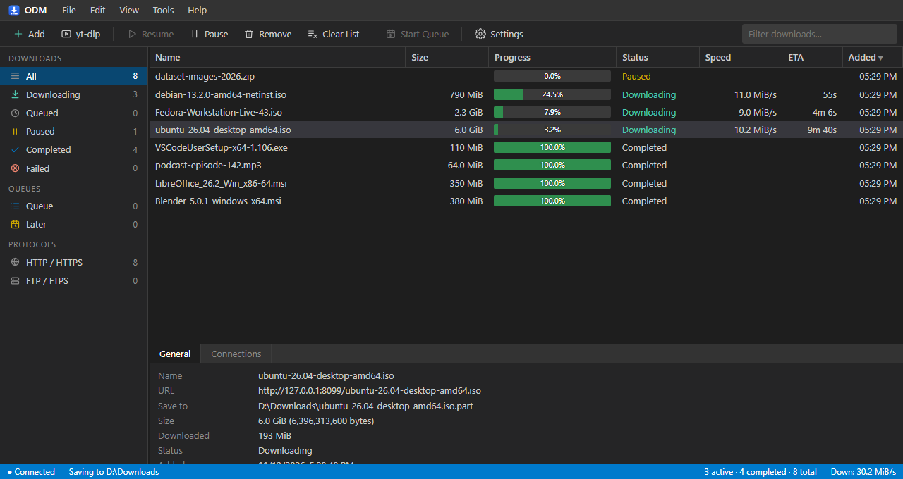
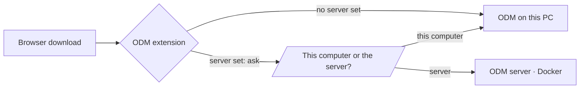

<div align="center">


# Open Download Manager

**A fast, segmented download manager for Windows and your own server — and a browser extension that asks,
for every download: _this computer, or the server?_**

[](https://github.com/aoztrk82/open-download-manager/releases/latest)
[](https://hub.docker.com/r/aoztrk82/odm)
[](https://hub.docker.com/r/aoztrk82/odm)


[Download for Windows](https://github.com/aoztrk82/open-download-manager/releases/latest) ·
[Run it on a server](#-on-a-server-docker) ·
[Browser extensions](#-browser-extensions) ·
[CLI](#-command-line)



</div>

---

## ✨ Highlights

|  |  |
|---|---|
| ⚡ **Segmented & resumable** | Starts with 2 connections and adds more while the speed keeps rising (up to your CPU threads). Finished connections split the largest remaining piece. Pause, quit, reboot — it picks up where it left off. |
| 🖥️ **Local _or_ server, per download** | Add your server's URL + token to the extension and every captured download asks where it should go. No server? It just downloads locally. |
| 🎬 **Video button** | Hover any playing video for a button that lists its files and qualities with sizes — direct files, player configs and **HLS streams** (AES-128, fMP4), joined into a single MP4. |
| 📺 **yt-dlp built in** | YouTube and a thousand other sites: pick a quality, MP4 or MKV, or a whole playlist. yt-dlp, QuickJS and a small ffmpeg ship with ODM — nothing to install. |
| 🗂️ **Queues & scheduling** | Run downloads all at once, one after another, or put them in a **Later** queue that starts on a schedule with a pause between files. |
| 🎛️ **Settings that matter** | Category folders, file-type and site rules for the browser, per-site connection limits, per-download and total speed limits, progress and "download complete" windows with taskbar progress. |
| 🌐 **Web UI everywhere** | The same UI runs in the desktop window and in any browser against your server. English and Turkish. |
| 🔒 **Safe by default** | The local daemon only answers loopback and its own extensions; server mode requires a token. |
| 📝 **A log that explains** | Every add, server answer, retry and failure is logged, so "it didn't download" has an answer. |

## 🪟 On Windows

1. Download **`odm-setup-<version>.exe`** from [Releases](https://github.com/aoztrk82/open-download-manager/releases/latest)
   and run it — per user, no admin rights needed.
2. ODM starts in the notification area. Open **Settings › General** and install the browser extension for
   Firefox, Chrome or Edge from there.
3. Downloads you start in the browser now open ODM's download dialog.

ffmpeg, yt-dlp and QuickJS are inside the installer; you never install them yourself.

## 🐳 On a server (Docker)

Multi-arch image (**amd64** and **arm64**, e.g. a Raspberry Pi) with the Web UI, yt-dlp, QuickJS and ffmpeg.

```bash
docker run -d --name odm -p 6800:6800 \
  -e ODM_TOKEN=$(openssl rand -hex 32) -e TZ=Europe/Istanbul \
  -v ./downloads:/downloads -v ./config:/config \
  --restart unless-stopped \
  aoztrk82/odm:latest
```

Or with Compose: grab [docker-compose.yml](docker-compose.yml), put `ODM_TOKEN=...` in a `.env` next to it and run
`docker compose up -d`.

Then open `http://<host>:6800` and enter the token.

| Path | What lives there |
|---|---|
| `/downloads` | finished files |
| `/config` | database, settings, download log (`/config/odm/logs/odm.log`) |

The container runs as uid 1000; set `user: "1001:1001"` (or similar) if your download folder belongs to someone
else. For access from the internet, put it behind a reverse proxy with TLS.

## 🧩 Browser extensions

The extensions come **from ODM itself** (Settings › General), so their version always matches the program.
Firefox gets a Mozilla-signed add-on; Chrome and Edge load it unpacked from a folder ODM keeps up to date.



To use a server: in the extension's settings add the server URL and its token. From then on each captured
download asks where to go, with its own folder choice for each side.

## ⌨️ Command line

`odm.exe` is the daemon, the tray app and the CLI in one binary.

```bash
odm add https://example.com/file.iso          # starts the local daemon if needed
odm list
odm watch                                      # live view
odm pause|resume|rm <id>

odm serve --local                              # 127.0.0.1:6800, no token (loopback + extensions only)
odm serve --listen :6800 --token SECRET        # server mode with the Web UI at /
odm --server http://host:6800 --token SECRET add <url>
```

## 🛠️ Building from source

```bash
cd extension && pnpm install && pnpm build     # build the extension first: odm.exe embeds it
go build -o odm.exe ./cmd/odm
go vet ./... && go test ./...
docker build -t odm .                          # or scripts/docker-build.ps1 [-Test] [-Push]
powershell -File scripts/build-installer.ps1   # Windows installer (Inno Setup)
```

<details>
<summary>Project layout</summary>

```
cmd/odm            CLI, daemon, tray, WebView2 window, native-messaging host
internal/engine    segmented, resumable engine with dynamic connections; HLS downloads
internal/proto     HTTP and FTP sources behind one interface
internal/queue     scheduler, queues (now / one by one / later), events
internal/store     SQLite (pure Go, no cgo)
internal/api       REST + WebSocket API, Go client, auth guards
internal/web       embedded Web UI
internal/hls       HLS playlist parsing
internal/ffmpeg    finds the bundled ffmpeg, remuxes without re-encoding
internal/ytdlp     yt-dlp integration (probe, download, update)
extension/         one TypeScript codebase, built for Chrome and Firefox
tools/ffmpeg       build scripts for the small LGPL ffmpeg (Windows + Linux)
```

</details>

## 🙏 Built with

[yt-dlp](https://github.com/yt-dlp/yt-dlp) · [QuickJS-NG](https://github.com/quickjs-ng/quickjs) ·
[FFmpeg](https://ffmpeg.org) (LGPL, remux-only build) · [modernc SQLite](https://gitlab.com/cznic/sqlite) ·
[Cobra](https://github.com/spf13/cobra) · WebView2
